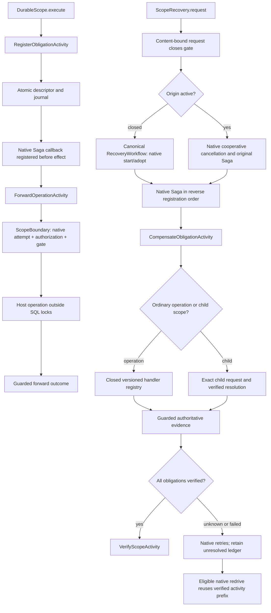

# Durable compensation scopes (experimental)

Implementation of the embedded, sequential scope design in
[retained compensation proposal](https://github.com/durable-workflow/workflow/issues/1063), preparing the
nested-machine integration in [business state-machine proposal](https://github.com/durable-workflow/workflow/issues/1069).
This is not a released API. Existing run-local Saga and the four-method
`TransitionStep` contract remain unchanged.

## Boundaries

A scope is `(application, namespace, key, generation)`. Its forward work belongs
to one originating run, so choose a generation unique to that run. Continuing,
redriving or retrying a child with an existing generation does not transfer its
ownership; new registration refuses with nonretryable `scope_execution_owner_mismatch`.
The native default namespace remains `null`; it is never replaced by an invented
alias. The original run and a later recovery run have separate identities. One scope
contains at most 256 obligations. Stored descriptors contain a closed handler
identifier and version, stable operation key and portable data (16 KiB, depth 8,
512 values). They never contain executable closures or arbitrary class names.
Applications store protected references instead of credentials or customer data.
Scope identities, obligations, forward results and compensation resolutions use
closed version-1 envelopes. Their canonical arrays are explicit rather than PHP
object layouts. Unsupported versions refuse interpretation. Recorded activity
types and activity-sequence version markers are durable identities.

The registration journal and obligation commit together. Workflow history records
activity boundary outcomes; a lost activity acknowledgement is adopted by exact
identity. Forward work must use the scope admission gate. Registering a descriptor
alone does not make an unrelated activity cancellation-safe.

Live database, authorization and handler resolution happen at activity boundaries,
never during deterministic replay. Native activity retries and native Saga remain
responsible for execution. No independent timer, worker or retry engine is added.
Every scope derives one canonical recovery workflow instance ID. Native DW
start/adopt admits one run; native redrive admits one successor after an eligible
failure. A native returned-existing-active start receipt remains eligible for
redrive only when its run identity and accepted start-command snapshot match.
A retained request pins its first native route, predecessor and initial profile.
Repeating that key returns its original admission receipt, including after that
run fails or an operator cancels or terminates it. Each additional recovery run
requires a fresh authorized scope request key. Native activity attempts and
backoff within the same run keep their existing identities. Scope progress must be written
under the current native activity attempt's authority, in the same database transaction as the ledger mutation. A status check
followed by an unguarded write is insufficient. No scope lease or separate owner
claim is introduced. Native fencing cannot recall an issued external request.
Handlers must reconcile unknown provider outcomes using stable operation keys.
A returned callback, timeout or expired lease is not verified compensation.

Rows use the workflow storage connection. Scope rows serialize ledger mutations;
obligation and journal rows follow that lock. No external call runs under a database
lock. The ledger has no cascading foreign key to run history: normal history
pruning must not erase unresolved obligations or reuse their identities.

## Runtime flow and responsibilities

`ScopeBoundary` uses the existing native activity status/authority checks while
retaining their SQL locks in the ledger transaction. Its lock order is native
attempt, execution, run and task, followed by the scope and its journal. It checks
authority again after the mutation. Host authorization and handler input
validation run before the transaction, with no native or scope locks held. The
transaction rechecks native authority, request identity and the validated forward
descriptor before admitting work. Provider calls run between guarded transactions,
never inside them. The journal records principal, authorization policy version,
origin/current run, activity and attempt references. Child participation records
the child authorization policy separately from the parent registration policy.
A missing or invalid policy version refuses participation before registration.
The host must bind
`ScopeAuthorization`; there is no permissive default.

`HandlerRegistry` is supplied by trusted host code. Its entries implement
`ScopedOperation::assertInput()`, `execute()` and `compensate()`. These are provider
boundary handlers; they do not change the four `TransitionStep` methods. Forward
and compensation outcomes accept a list of at most 32 immutable evidence
references, each at most 128 bytes. This leaves room for native identity metadata inside the
existing 16 KiB, 512-value journal bound. Larger provider proofs should be stored
as protected evidence bundles and referenced by a stable identifier. An
uncertain forward result requires reconciliation against the stable operation ID
before an unsafe provider reissue. `Resolution::verified()` additionally requires
settled-forward evidence; neither a callback return nor a native terminal run proves
that business result. Handler unavailability and descriptor hash mismatch refuse
before both forward and compensation provider operations. Forward handler and input
validation run before dispatch admission: a missing pinned handler or incompatible
input retains its native nonretryable reason without creating provider uncertainty.
A refused retry preserves any earlier uncertain attempt. Exceptions after provider
dispatch remain unknown and require reconciliation, even if their PHP type is
nonretryable.

`ChildScopes` registers compensation participants, not state-machine bindings.
The initial graph is a bounded tree with one nesting level, at most 16 children
per parent and at most 256 obligations per scope (at most 4,352 across that tree).
Children cannot be shared between parents. One application/namespace graph-integrity
row serializes edge changes before scope locks. It contains no executor, lease,
heartbeat or retry state. A missing or unverified child stops earlier parent work.
Long child cleanup can exhaust the ordinary native activity retry budget; the
parent remains unresolved. A failed child requires a fresh authorized child
request. The stable parent-operation key never creates that request implicitly.
After the child ledger becomes verified, a fresh authorized parent request can
redrive the parent and observe that result before earlier parent work resumes.

A scope stays attached to its original native run for forward execution. This
increment does not transfer forward ownership across continue-as-new or origin
redrive. The first accepted request pins the cleanup principal. Later authorized
requests can route recovery but cannot replace that principal. Recovery evaluates
current authorization again at every activity boundary. Revoked authority leaves
work unresolved rather than silently adopting another principal. Requesting cleanup
on an active origin requests cancellation of the entire native run: all its Saga
callbacks can run, including other scopes and ordinary non-scope compensations.

The default scoped forward/compensation activities use three native attempts and
the native backoff. No scope retry loop is introduced. `DurableScope.execute()`
accepts native `ActivityOptions` for forward work. Immediate terminal cancellation
or termination can prevent cleanup; retained obligations remain for explicit
recovery. A request accepted on an active origin is durable routing evidence; if
that origin closes without resolving its obligations, repeat the same authorized
request to route it to canonical recovery.

Cancelled or terminated canonical recovery can restart on that same instance
only through a fresh authorized request naming its exact current predecessor.
The origin and retained obligations stay fixed; old terminal histories stay
immutable. The initial recovery profile is independent of the closed forward
run. Restarts inherit the canonical recovery's absolute execution and run
deadlines and routing, with no renewed technical allowance. Exhausted deadlines
refuse another restart and leave the obligations unresolved.

`ScopeRetention::release()` requires verified work and terminal native executions,
and refuses a child still retained by an unresolved parent. It removes retained
inputs and forward results while preserving scope/generation, operation and request
identities, fingerprints, outcome references and journal tombstones. Forward
observation references are recorded in the immutable journal before release.
The journal does not retain the forward business value or obligation input.
No automatic expiry is added. Ordinary run-detail pruning cannot cascade into this ledger.

## Continue-as-new and originating-run redrive

Scope identity and native child supervision are separate. When a workflow
continues as new, native DW can hand its still-open children to the continued
run. This does not transfer the parent's compensation scope or the children's
own scopes. Each retained scope keeps its `original_run_id`. A parent that must
compensate a child registers it with `participate()` before dispatch, regardless
of which run later supervises that child.

New registration from a continued or redriven origin is refused by the retained
original-run binding. A redrive may replay an observed activity prefix, but it
cannot use that prefix to dispatch new work in the old scope. Resuming an
uncertain forward activity in the successor is also refused by `ScopeBoundary`
before provider dispatch. The original obligations and provider evidence remain
available. Hosts request `ScopeRecovery` for that exact identity and generation
to resolve them. This increment does not silently create replacement scopes,
move obligations to a new generation or infer compensation from run closure.

`V2CompensationScopeRunBoundaryTest` exercises real continue-as-new with an open
scoped child, native supervision handoff, refused successor work and verified
child-first recovery. It also checks originating-run redrive after an unrelated
failed activity and after an uncertain scoped forward effect. Recovery preserves
the original terminal history in all cases.

## Authoring and host setup

The embedded host binds `ScopeAuthorization` to its authorization policy and
`HandlerRegistry` to a closed map of handler type/version pairs. Normal package
migrations create the ledger tables on the configured workflow storage connection.
No additional queue, worker or lease configuration is required.

Derive `$principal` from trusted application policy code; never accept its identity
from an HTTP/webhook payload or workflow-start argument. The authorization binding
must verify that principal against the host's current trusted security context.
Stored SHA-256 content hashes detect accidental corruption; database write access
remains inside the host's trust boundary.

Inside a native workflow, create `DurableScope($this, $identity, $principal)` and
call `execute(new Obligation($key, $handlerType, $handlerVersion, $input))`. Register
all effects through this helper. On cleanup, call the existing
`$this->compensate()` and then `$scope->verifyCompensation()`. The helper does not
catch the application's business failures or decide its business state.

`participate($key, $childIdentity)` registers a compensation participant. It does
not start a child, await its business result or establish a state-machine binding.
Register that participant before dispatching new child work. Each child registers
its own provider obligations before effects. A missing child remains unresolved
and cannot satisfy the parent barrier.

After the origin closes, the host calls `ScopeRecovery::request($identity,
$requestKey, $principal, $reason, $initialProfile)`. The optional `StartOptions`
profile sets the initial recovery budget; retain that same profile on later
requests. Obtain the principal from trusted application
authorization, not from untrusted request content. Repeating the same request
requires the same principal, reason and profile. A returned failed/stopped
receipt means recovery remains unresolved; inspect it and submit a fresh
authorized key to request another eligible run. Results report `recoveryStatus`,
`scopeStatus` and `nextAction`; `submit_fresh_authorized_request` identifies that
boundary. Only the verified scope ledger clears the unresolved obligation.
Inspecting or requesting retained work
must go through an authorized host boundary; the `@internal` persistence classes
are not an HTTP-facing data access API.
