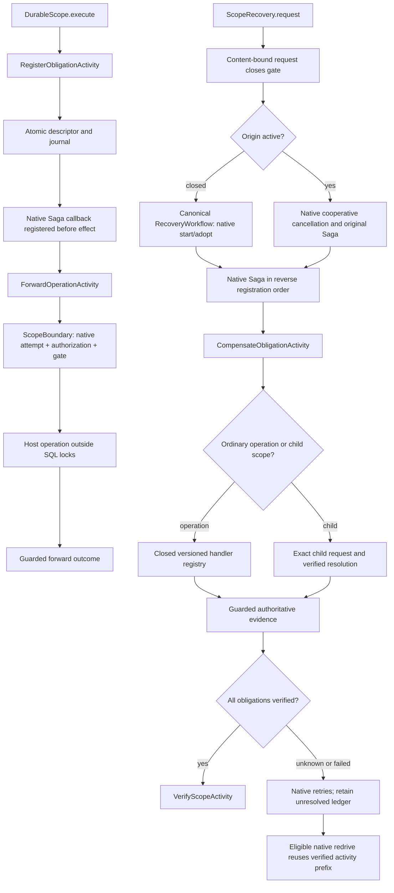

# Durable compensation scopes (experimental)

Implementation of the embedded, sequential scope design in
[retained compensation proposal](https://github.com/durable-workflow/workflow/issues/1063), preparing the
nested-machine integration in [business state-machine proposal](https://github.com/durable-workflow/workflow/issues/1069).
This is not a released API. Existing run-local Saga and the four-method
`TransitionStep` contract remain unchanged.

## Reviewable increments

1. Retained identities, bounded portable descriptors and atomic registration
   journal. Prove exact duplicate adoption, conflicting reuse refusal, namespace
   and generation separation, and rollback of incomplete registration.
2. Content-bound cancellation requests and canonical recovery identity. Reuse
   native start/adopt, task ownership, activity attempts and redrive. Do not add
   another executor, lease, claim table, heartbeat or retry policy engine.
   Prove duplicate routing, closure races, namespace/generation substitution and
   refused identity reuse.
3. Recorded activity boundaries and native Saga recovery, including closed runs.
   Prove cold replay, registration acknowledgement loss, handler unavailability,
   authorization, cancellation and recovery after worker restart.
4. Sequential child-scope participants and verified child-first compensation.
   Prove generation binding, missing child evidence, cycle refusal and bounded
   participation. State-bound SM bindings and the two-integration example remain
   the next business state-machine slice, after this retained-scope foundation.
5. Retention and compatibility review; run ECS, PHPStan, unit, coverage and feature
   gates. Record the limits of local evidence separately from CI qualification.

Each increment follows tests, implementation, review, fixes and repeated review.
The issue remains the work record; this document defines the technical contract.

## Boundaries

A scope is `(application, namespace, key, generation)`, not a workflow run.
The native default namespace remains `null`; it is never replaced by an invented
alias. The original run and a later recovery run have separate identities. One scope
contains at most 256 obligations. Stored descriptors contain a closed handler
identifier and version, stable operation key and portable data (16 KiB, depth 8,
512 values). They never contain executable closures or arbitrary class names.
Applications store protected references instead of credentials or customer data.

The registration journal and obligation commit together. Workflow history records
activity boundary outcomes; a lost activity acknowledgement is adopted by exact
identity. Forward work must use the scope admission gate. Registering a descriptor
alone does not make an unrelated activity cancellation-safe.

Live database, authorization and handler resolution happen at activity boundaries,
never during deterministic replay. Native activity retries and native Saga remain
responsible for execution. No independent timer, worker or retry engine is added.
Every scope derives one canonical recovery workflow instance ID. Native DW
start/adopt admits one run; native redrive admits one successor after an eligible
failure. A native returned-existing-active start receipt remains eligible for
redrive only when its run identity and accepted start-command snapshot match.
A technical redrive key includes the exact failed source run. One unchanged
retained request can therefore recover several failed successors while duplicate
requests for one source adopt the same successor. Scope progress must be written
under the current native activity attempt's authority, in the same database transaction as the ledger mutation. A status check
followed by an unguarded write is insufficient. No scope lease or separate owner
claim is introduced. Native fencing cannot recall an issued external request.
Handlers must reconcile unknown provider outcomes using stable operation keys.
A returned callback, timeout or expired lease is not verified compensation.

Rows use the workflow storage connection. Scope rows serialize ledger mutations;
obligation and journal rows follow that lock. No external call runs under a database
lock. The ledger has no cascading foreign key to run history: normal history
pruning must not erase unresolved obligations or reuse their identities.

## Evidence

Checked before implementation: upstream main `46ca8f67` contains the native
ownership guarantees. Four isolated PostgreSQL probes (32 assertions) proved
concurrent canonical start, concurrent redrive, exclusive workflow-task claim and
the fact that `business_key` alone does not deduplicate different instance IDs.
Three upstream PostgreSQL cancellation concurrency tests (160 assertions) preserved
canonical request/root/budget and explicitly refused a conflicting root.

The first ledger increment passed 11 targeted tests (23 assertions), including an
injected journal-insert failure. It does not yet prove workflow-boundary integration.
The previous draft's recovery lease tests described an unimplemented competing
mechanism; they are replaced by tests of native identity and authority integration.

## Runtime flow and responsibilities

`ScopeBoundary` uses the existing native activity status/authority checks while
retaining their SQL locks in the ledger transaction. Its lock order is native
attempt, execution, run and task, followed by the scope and its journal. It checks
authority again after the mutation. Provider calls run between guarded transactions,
never inside them. The journal records principal, authorization policy version,
origin/current run, activity and attempt references. Child participation records
the child authorization policy separately from the parent registration policy.
A missing or invalid policy version refuses participation before registration.
The host must bind
`ScopeAuthorization`; there is no permissive default.

`HandlerRegistry` is supplied by trusted host code. Its entries implement
`ScopedOperation::assertInput()`, `execute()` and `compensate()`. These are provider
boundary handlers; they do not change the four `TransitionStep` methods. Forward
and compensation outcomes accept a list of at most 32 immutable evidence
references, each at most 128 bytes. This leaves room for native identity metadata inside the
existing 16 KiB, 512-value journal bound. Larger provider proofs should be stored
as protected evidence bundles and referenced by a stable identifier. An
uncertain forward result requires reconciliation against the stable operation ID
before an unsafe provider reissue. `Resolution::verified()` additionally requires
settled-forward evidence; neither a callback return nor a native terminal run proves
that business result. Handler unavailability and descriptor hash mismatch refuse
before both forward and compensation provider operations. Forward handler and input
validation run before dispatch admission: a missing pinned handler or incompatible
input retains its native nonretryable reason without creating provider uncertainty.
A refused retry preserves any earlier uncertain attempt. Exceptions after provider
dispatch remain unknown and require reconciliation, even if their PHP type is
nonretryable.

`ChildScopes` registers compensation participants, not state-machine bindings.
The initial graph is a bounded tree with one nesting level, at most 16 children
per parent and at most 256 obligations per scope (at most 4,352 across that tree).
Children cannot be shared between parents. One application/namespace graph-integrity
row serializes edge changes before scope locks. It contains no executor, lease,
heartbeat or retry state. A missing or unverified child stops earlier parent work.
Long child cleanup can exhaust the ordinary native activity retry budget; the
parent remains unresolved and can resume through eligible native redrive.

A scope stays attached to its original native run for forward execution. This
increment does not transfer forward ownership across continue-as-new or origin
redrive. The first accepted request pins the cleanup principal. Later authorized
requests can route recovery but cannot replace that principal. Recovery evaluates
current authorization again at every activity boundary. Revoked authority leaves
work unresolved rather than silently adopting another principal.

The default scoped forward/compensation activities use three native attempts and
the native backoff. No scope retry loop is introduced. `DurableScope.execute()`
accepts native `ActivityOptions` for forward work. Immediate terminal cancellation
or termination can prevent cleanup; retained obligations remain for explicit
recovery. A request accepted on an active origin is durable routing evidence; if
that origin closes without resolving its obligations, repeat the same authorized
request to route it to canonical recovery.

`ScopeRetention::release()` requires verified work and terminal native executions,
and refuses a child still retained by an unresolved parent. It removes retained
inputs and forward results while preserving scope/generation, operation and request
identities, fingerprints, outcome references and journal tombstones. Forward
observation references are recorded in the immutable journal before release.
The journal does not retain the forward business value or obligation input.
No automatic expiry is added. Ordinary run-detail pruning cannot cascade into this ledger.

## Authoring and host setup

The embedded host binds `ScopeAuthorization` to its authorization policy and
`HandlerRegistry` to a closed map of handler type/version pairs. Normal package
migrations create the ledger tables on the configured workflow storage connection.
No additional queue, worker or lease configuration is required.

Inside a native workflow, create `DurableScope($this, $identity, $principal)` and
call `execute(new Obligation($key, $handlerType, $handlerVersion, $input))`. Register
all effects through this helper. On cleanup, call the existing
`$this->compensate()` and then `$scope->verifyCompensation()`. The helper does not
catch the application's business failures or decide its business state.

`participate($key, $childIdentity)` registers a compensation participant. It does
not start a child, await its business result or establish a state-machine binding.
Register that participant before dispatching new child work. Each child registers
its own provider obligations before effects. A missing child remains unresolved
and cannot satisfy the parent barrier.

After the origin closes, the host calls `ScopeRecovery::request($identity,
$requestKey, $principal, $reason)`. Obtain the principal from trusted application
authorization, not from untrusted request content. Repeating the same request
requires the same principal and reason. Inspecting or requesting retained work
must go through an authorized host boundary; the `@internal` persistence classes
are not an HTTP-facing data access API.

## Evidence and review

| Guarantee | Responsible component | Acceptance test |
| --- | --- | --- |
| Exact request and generation identity | ScopeIdentity, ScopeRepository, ScopeRecovery | ScopeRecoveryTest, V2CompensationScopeConcurrencyTest |
| Current native attempt owns ledger mutation | ScopeBoundary | ExpiredNativeAttemptCannotPublishVerifiedCompensation |
| No false success for late/unknown effects | ScopeProgress, CompensateObligationActivity | PossibleLateForwardEffectCannotBecomeVerifiedAfterRetryExhaustion |
| Closed-run recovery and original terminal history | RecoveryWorkflow, native Saga | ClosedOriginUsesCanonicalRecoveryAndKeepsOriginalTerminalHistory |
| Verified progress survives failure and redrive | Native redrive plus ledger | RetryExhaustionStaysUnresolvedAndNativeRedriveReusesVerifiedWork, OneRetainedRequestCanRedriveTwoFailuresWithoutRepeatingVerifiedWork |
| Native start adoption preserves eligible redrive | FailedRunRedrivePlan | NativeActiveAdoptionDoesNotPreventRecoveryRedriveAfterFailure, SubstitutedActiveStartAdoptionCannotAuthorizeRedrive |
| Forward evidence survives explicit release | ScopeProgress, ScopeRetention | ForwardEvidenceSurvivesReleaseWithoutRetainingBusinessInputsOrResults |
| Replay does no handler/provider resolution | DurableScope, recorded activities | ColdReplayDoesNotResolveMutableHandlersOrRepeatProviderEffects |
| Child-first sequential progress | ChildScopes, ChildResolution | CompletedChildScopeIsVerifiedBeforeEarlierParentCompensation, CancellationWhileChildWaitsResolvesItsSagaBeforeEarlierParentWork |
| Child authorization evidence | RegisterChildScopeActivity | ChildParticipationRecordsItsOwnAuthorizationPolicyVersion, InvalidChildParticipationPolicyCannotRegisterAChild |
| Retained descriptor integrity before effects | ForwardOperationActivity, CompensateObligationActivity | TamperedRegistrationCannotReachTheForwardProvider, TamperedRetainedDescriptorIsRefusedBeforeProviderCall |
| Live storage is forbidden during replay | ScopeRepository, ScopeStorage | OpeningLiveStorageFromWorkflowReplayIsRefusedBeforeWriting |
| Bounded retained work | ScopeRepository, ChildScopes | ObligationLimitCannotLeaveAPartialRegistration, ChildFanOutLimitCannotLeaveAPartialParticipant |
| No cycle under concurrent registration | ChildScopes integrity lock | CompetingEdgesCannotCreateACycle |
| Ordinary pruning preserves recovery | Independent retained ledger | OrdinaryRunPruningPreservesRetainedScopeRecovery |
| Explicit release cannot reuse identifiers | ScopeRetention | ReleaseRefusesUnresolvedWorkThenRetainsAnUnreusableTombstone |
| Fresh-process recovery | Native workflow and persisted ledger | RetainedRecoveryRunsInAFreshPhpProcess |

Integration exposed a native redrive limitation: `ActivityRetryScheduled` was
refused as unsupported history. `ActivityRetryHistory` validates exact execution,
attempt counters and task lineage before the existing redrive planner accepts that
history. Substitution controls accompany the real retry-exhaustion regression.

Local evidence does not establish a published package, CI matrix qualification,
service-mode/cross-SDK support or production-provider behavior. The full quality
cycle and final evidence counts are recorded after the last code review.
