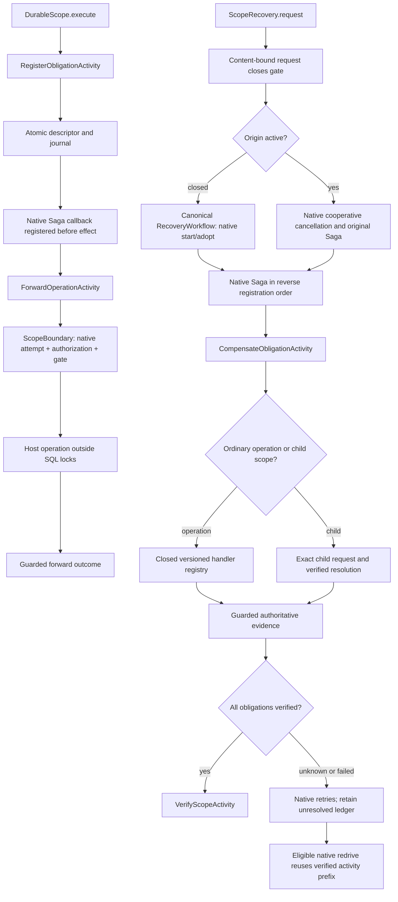

# Durable compensation scopes

Implementation of the embedded, sequential scope design in
[retained compensation proposal](https://github.com/durable-workflow/workflow/issues/1063), preparing the
nested-machine integration in [business state-machine proposal](https://github.com/durable-workflow/workflow/issues/1069).
These APIs first shipped in 2.29.0 as experimental. From the release that ships
their promotion (after 2.32.0; see the CHANGELOG), the authoring, handler-contract
and host APIs are stable; see
[API stability](api-stability.md#compensation-scopes) for the exact members and
guarantees. Reserved child admission (`reserveChild()`) and original root
admission remain experimental. Existing run-local Saga and the four-method
`TransitionStep` contract remain unchanged.

## Boundaries

A scope is `(application, namespace, key, generation)`. Its forward work belongs
to one originating run, so choose a generation unique to that run. Continuing,
redriving or retrying a child with an existing generation does not transfer its
ownership; new registration refuses with nonretryable `scope_execution_owner_mismatch`.
The native default namespace remains `null`; it is never replaced by an invented
alias. The original run and a later recovery run have separate identities. One scope
contains at most 256 obligations, including at most 16 child participants. Stored
descriptors contain a closed handler identifier and version, a stable operation key
and portable input. Input is limited to 15,360 bytes as JSON, 500 values and depth 7
on its own; the descriptor envelope is reserved above that. Descriptors never contain
executable closures or arbitrary class names. Identifiers (application, key,
generation, operation key, handler version) use 1 to 128 characters from
`A-Z a-z 0-9 . _ : / -` and start with a letter or digit. Handler types use
`a-z 0-9 . _ -`, start with a lowercase letter, and must not start with `dw.`, which
is reserved for the engine. Workflows that record the
`dw.compensation.registration-checks` patch refuse such types at registration. A
`HandlerRegistry` may still map a `dw.` type that an earlier history registered, so
those obligations stay compensable; the engine's own child-scope types cannot be mapped. `ScopeIdentity::id()` is the lowercase hex SHA-256 of
the canonical JSON of the identity, and the canonical recovery workflow (type
`dw.compensation.recovery.v1`) runs on instance `dw-compensation-<id>`.
Applications store protected references instead of credentials or customer data.
Scope identities, obligations, forward results and compensation resolutions use
closed version-1 envelopes. Their canonical arrays are explicit rather than PHP
object layouts. Unsupported versions refuse interpretation. Recorded activity
types and activity-sequence version markers are durable identities.

The registration journal and obligation commit together. Workflow history records
activity boundary outcomes; a lost activity acknowledgement is adopted by exact
identity. Forward work must use the scope admission gate. Registering a descriptor
alone does not make an unrelated activity cancellation-safe.

Live database, authorization and handler resolution happen at activity boundaries,
never during deterministic replay. Native activity retries and native Saga remain
responsible for execution. No independent timer, worker or retry engine is added.
Every scope derives one canonical recovery workflow instance ID. Native DW
start/adopt admits one run; native redrive admits one successor after an eligible
failure. A native returned-existing-active start receipt remains eligible for
redrive only when its run identity and accepted start-command snapshot match.
A retained request pins its first native route, predecessor and initial profile.
Repeating that key returns its original admission receipt, including after that
run fails or an operator cancels or terminates it. Each additional recovery run
requires a fresh authorized scope request key. Native activity attempts and
backoff within the same run keep their existing identities. Scope progress must be written
under the current native activity attempt's authority, in the same database transaction as the ledger mutation. A status check
followed by an unguarded write is insufficient. No scope lease or separate owner
claim is introduced. Native fencing cannot recall an issued external request.
Handlers must reconcile unknown provider outcomes using stable operation keys.
A returned callback, timeout or expired lease is not verified compensation.

Rows use the workflow storage connection. Scope rows serialize ledger mutations;
obligation and journal rows follow that lock. No external call runs under a database
lock. The ledger has no cascading foreign key to run history: normal history
pruning must not erase unresolved obligations or reuse their identities.

## Runtime flow and responsibilities



Recovery activities also require the paired native creation command/history
receipt for their exact run, scope and original owner. A generic start at the
canonical ID cannot borrow a retained request's principal. The boundary checks
fresh receipt data before host authorization and again under the native locks.

`ScopeBoundary` uses the existing native activity status/authority checks while
retaining their SQL locks in the ledger transaction. Its lock order is native
attempt, execution, run and task, followed by the scope and its journal. It checks
authority again after the mutation. Host authorization and handler input
validation run before the transaction, with no native or scope locks held. The
transaction rechecks native authority, request identity and the validated forward
descriptor before admitting work. Provider calls run between guarded transactions,
never inside them. The journal records principal, authorization policy version,
origin/current run, activity and attempt references. Child participation records
the child authorization policy separately from the parent registration policy.
A missing or invalid policy version refuses participation before registration.
The host must bind
`ScopeAuthorization`; there is no permissive default. To refuse permanently, throw
`ScopeAuthorizationRefused`, including for an operation name the policy does not
know. Any other exception is treated as transient: activity boundaries retry it, and
automatic recovery tries again on a later watchdog pass. A refusal while a parent
compensates a child participant is also permanent: the parent obligation becomes
`failed` with reason `authorization-refused`, and the activity fails with
non-retryable `scope_authorization_refused` until a fresh authorized request.

`HandlerRegistry` is supplied by trusted host code. Its entries implement
`ScopedOperation::assertInput()`, `execute()` and `compensate()`. These are provider
boundary handlers; they do not change the four `TransitionStep` methods. Forward
and compensation outcomes accept a list of at most 32 immutable evidence
references, each at most 128 bytes. This leaves room for native identity metadata inside the
existing journal bound. Larger provider proofs should be stored as protected
evidence bundles and referenced by a stable identifier.

`execute()` returns `ForwardResult::observed($value, $evidence)` (value limited to
11,264 bytes, 400 values and depth 7 for workflows that record the
`dw.compensation.registration-checks` patch; runs recorded before it keep the envelope
limit), `unknown($reason)` when the outcome is
uncertain, or `rejected($reason, $evidence)` when the provider definitely made no
effect. A rejected forward fails the workflow's call with non-retryable
`scope_forward_rejected`, and its compensation verifies without a provider call.
`OperationContext::$reconcileBeforeForward` is true when an earlier forward attempt
may have taken effect; reconcile by operation ID before an unsafe reissue.
`compensate()` returns `Resolution::verified($evidence)` only when the effect is
undone and no late forward effect is possible, `unknown($reason)` otherwise, or
`failed($reason)` when compensation definitely cannot complete; a failed obligation
is not retried in that run and stays visible until a fresh authorized request.
`OperationContext::$forwardOutcomeUnconfirmed` is true when the forward effect was
never confirmed observed. Neither a callback return nor a native terminal run proves
that business result. Handler unavailability and descriptor hash mismatch refuse
before both forward and compensation provider operations. Forward handler and input
validation run before dispatch admission: a missing pinned handler or incompatible
input retains its native nonretryable reason without creating provider uncertainty.
A refused retry preserves any earlier uncertain attempt. Exceptions after provider
dispatch remain unknown and require reconciliation, even if their PHP type is
nonretryable.

The one exception is `HandlerContractViolation`. The `ForwardResult` and `Resolution`
factories throw it for an invalid reason, evidence or value, and the engine raises it
for an observed value over the limit. The outcome is recorded as unknown, so
compensation still reconciles by operation ID, and the activity fails with
non-retryable `scope_handler_contract_violation` followed by the violation message
instead of retrying as `provider-outcome-unknown`. Handlers written for earlier
releases that call `Resolution::verified($evidence, true)` keep working with an
`E_USER_DEPRECATED` notice; `verified($evidence, false)` returns
`unknown('late-forward-possible')`.

`ChildScopes` registers compensation participants, not state-machine bindings.
The initial graph is a bounded tree with one nesting level, at most 16 children
per parent and at most 256 obligations per scope (at most 4,352 across that tree).
Children cannot be shared between parents. One application/namespace graph-integrity
row serializes edge changes before scope locks. It contains no executor, lease,
heartbeat or retry state. A missing or unverified child stops earlier parent work.
A child cleanup that outlasts the recovery run's compensation retry schedule
leaves the parent unresolved. That schedule outlasts one crashed child attempt
(see below). A failed child requires a fresh authorized child
request. The stable parent-operation key never creates that request implicitly.
After the child ledger becomes verified, a fresh authorized parent request can
redrive the parent and observe that result before earlier parent work resumes.

A scope stays attached to its original native run for forward execution. This
increment does not transfer forward ownership across continue-as-new or origin
redrive. The first accepted request pins the cleanup principal. Later authorized
requests can route recovery but cannot replace that principal. Recovery evaluates
current authorization again at every activity boundary. Revoked authority leaves
work unresolved rather than silently adopting another principal. Requesting cleanup
on an active origin requests cancellation of the entire native run: all its Saga
callbacks can run, including other scopes and ordinary non-scope compensations.

The default scoped forward and in-origin compensation activities use three
native attempts and the native backoff. An origin compensating under cooperative
cancellation therefore fails fast and hands unresolved work to recovery.
`DurableScope.execute()` accepts native `ActivityOptions` for forward work.
Immediate terminal cancellation or termination can prevent cleanup; retained
obligations remain for recovery. No scope retry loop is introduced.

### Automatic recovery after the origin closes

A request accepted on an active origin is durable routing evidence. If that origin
closes without resolving its obligations, the task watchdog routes the scope to
canonical recovery on its next pass. The watchdog runs on queue worker loops and in
`workflow:v2:repair-pass`. It repeats the scope's primary request: the same key,
principal and reason an operator would repeat. The route is bound per request under
the scope lock, and native admission to the canonical recovery instance returns an
existing active run. Concurrent passes or a racing manual request therefore start
one recovery run. A scope whose request already routed to recovery is not routed
again: a failed recovery run still needs a fresh authorized request.

The primary principal is authorized again for `request` immediately before
routing. If that refuses, or the principal no longer exists in the host's policy,
nothing is started. The ledger journal records one `recovery_authorization_failed`
entry, and the watchdog does not retry it. `ScopeRecovery::describe($identity,
$principal)` reports it as `automaticRecovery: recovery_authorization_failed` with
the refusal, and `nextAction: submit_fresh_authorized_request`. A fresh authorized
request then routes recovery manually.

### Recovery retry schedule

Compensation inside a canonical recovery run started after this change uses six
attempts. It waits 1, 2, 5 and 10 seconds, then one activity lease plus one
task-repair pass: `activity_task_lease_seconds + task_repair.loop_throttle_seconds
+ task_repair.failure_backoff_max_seconds`, about six minutes by default. A worker
can crash while a child participant is being compensated. The child's attempt then
holds its lease until task repair reclaims it, and the recovery run's last wait
outlasts that, so the parent settles without operator action. A persistent failure
still fails the recovery run after the sixth attempt, with the obligation left
unresolved.

`RecoveryWorkflow` gates the schedule with `patched()` and records the computed
values with `sideEffect()`. A later lease or repair configuration change therefore
cannot change replay. Recovery runs recorded before the change replay unchanged
with three attempts.

A waiting retry runs early when its reason to wait has gone. That happens on an
authorized request for the scope, and when a child participant's scope becomes
verified (for the parent's open runs). Waking moves only that retry's ready time.
It keeps the attempt number, the recorded maximum and the history unchanged, and a
retry that already ran or a run at its maximum is not affected.

Cancelled or terminated canonical recovery can restart on that same instance
only through a fresh authorized request naming its exact current predecessor.
The origin and retained obligations stay fixed; old terminal histories stay
immutable. The initial recovery profile is independent of the closed forward
run. Restarts inherit the canonical recovery's absolute execution and run
deadlines and routing, with no renewed technical allowance. Exhausted deadlines
refuse another restart and leave the obligations unresolved.

`ScopeRetention::release()` requires verified work and terminal native executions,
and refuses a child still retained by an unresolved parent. It removes retained
inputs and forward results while preserving scope/generation, operation and request
identities, fingerprints, outcome references and journal tombstones. Forward
observation references are recorded in the immutable journal before release.
The journal does not retain the forward business value or obligation input.
No automatic expiry is added. Ordinary run-detail pruning cannot cascade into this ledger.
Canonical recovery details, including both native receipt copies and redrive
links, remain pinned while the scope is retained. Verification alone does not
remove this hold because old authorized request keys still return their original
runs. Explicit release removes the hold; ordinary forward-origin details can be
pruned independently. Release authorization runs outside replay and SQL
transactions, before the atomic retirement mutation.

### Upgrade, schema rollback and downgrade

A schema rollback refuses while the ledger holds any scope, including a released
tombstone. Dropping those tables would discard unresolved obligations. Dropping
the tombstones would let an old generation or request key be accepted again. To
return to a release without these tables, restore a database backup taken before
the upgrade. An empty ledger rolls back normally.

The refusal happens before any migration in the rollback runs `down()`. When the
migrator starts a rollback or reset, the package checks every guarded migration in
that operation: the compensation ledger, child and root reservation fences and
schedule occurrence receipts. If any of them holds retained state, nothing is
rolled back, including newer migrations in the same batch. `--pretend` is not
refused because it runs no `down()`. `migrate:fresh` drops every table without
running `down()`, so it is not guarded.

Downgrading only the package (to 2.28.x or earlier) leaves the ledger tables and
rows in place. The older engine keeps running ordinary workflows on the upgraded
schema, but it has no recovery classes, so retained scopes cannot be recovered
or released. Its `migrate:rollback` cannot reach the newer migrations, because
their files are absent. Upgrading again resumes from the same ledger: a recovery
request then verifies the obligations the closed origin left behind, and the
origin's terminal history is unchanged. Do not downgrade while a recovery run is
open, because the older workers cannot load it.

`scripts/ci/compensation-scope-upgrade-smoke.sh` installs published 2.28.1 into a
new Laravel application and checks each of these steps against the candidate. It
runs on pull requests that change migrations or compensation code, and on every
stable release tag against the published package.

## Continue-as-new and originating-run redrive

Scope identity and native child supervision are separate. When a workflow
continues as new, native DW can hand its still-open children to the continued
run. This does not transfer the parent's compensation scope or the children's
own scopes. Each retained scope keeps its `original_run_id`. A parent that must
compensate a child registers it with `participate()` before dispatch, regardless
of which run later supervises that child.

New registration from a continued or redriven origin is refused by the retained
original-run binding. A redrive may replay an observed activity prefix, but it
cannot use that prefix to dispatch new work in the old scope. Resuming an
uncertain forward activity in the successor is also refused by `ScopeBoundary`
before provider dispatch. The original obligations and provider evidence remain
available. Hosts request `ScopeRecovery` for that exact identity and generation
to resolve them. This increment does not silently create replacement scopes,
move obligations to a new generation or infer compensation from run closure.

`V2CompensationScopeRunBoundaryTest` exercises real continue-as-new with an open
scoped child, native supervision handoff, refused successor work and verified
child-first recovery. It also checks originating-run redrive after an unrelated
failed activity and after an uncertain scoped forward effect. Recovery preserves
the original terminal history in all cases.

## Authoring and host setup

The embedded host binds `ScopeAuthorization` to its authorization policy and
`HandlerRegistry` to a closed map of handler type/version pairs. Normal package
migrations create the ledger tables on the configured workflow storage connection.
No additional queue, worker or lease configuration is required.

Derive `$principal` from trusted application policy code; never accept its identity
from an HTTP/webhook payload or workflow-start argument. The authorization binding
must verify that principal against the host's current trusted security context.
Stored SHA-256 content hashes detect accidental corruption; database write access
remains inside the host's trust boundary.

Inside a native workflow, create `DurableScope($this, $identity, $principal)` and
call `execute(new Obligation($key, $handlerType, $handlerVersion, $input))`. Register
all effects through this helper. On cleanup, call the existing
`$this->compensate()` and then `$scope->verifyCompensation()`. It returns
`['scopeId' => <id>, 'status' => 'verified']`; while any obligation is unresolved it
does not return, because its recorded verify activity fails. The helper does not
catch the application's business failures or decide its business state.

When business compensation order differs from forward dispatch order, use
`$registered = $scope->register($obligation)` and call `$registered->execute($options)`
later inside the same native workflow. Registration runs the existing recorded
register activity and installs the Saga callback; it does not invoke the
handler's forward operation. This lets an application register stock before
Payment, dispatch capture first, and still require refund before stock release.
The existing `execute()` shorthand records the same registration and forward
commands together.

The returned `RegisteredObligation` is a workflow-only reference reconstructed
during replay, not a portable client credential. Execution still passes through
the original engine-owned forward activity, native attempt authority and scope
admission fence. It cannot reopen a requested scope or authorize another owner.
Registration does not prove absence of an effect that was already dispatched.

`participate($key, $childIdentity)` registers a compensation participant. It does
not start a child, await its business result or establish a state-machine binding.
Register that participant before dispatching new child work. Each child registers
its own provider obligations before effects. A missing child remains unresolved
and cannot satisfy the parent barrier.

After the origin closes, the watchdog routes an accepted request automatically
(see above). The host calls `ScopeRecovery::request($identity, $requestKey,
$principal, $reason, $initialProfile)` itself for a request made after closure,
after an automatic route was refused, or after a recovery run failed. The optional `StartOptions`
profile sets the initial recovery budget; retain that same profile on later
requests. Obtain the principal from trusted application
authorization, not from untrusted request content. Repeating the same request
requires the same principal, reason and profile. A returned failed/stopped
receipt means recovery remains unresolved; inspect it and submit a fresh
authorized key to request another eligible run. Every result has exactly the keys
`route` (`origin`, `recovery`, `verified`), `runId`, `commandId`, `recoveryStatus`,
`scopeStatus` (`open`, `requested`, `verified`, `released`) and `nextAction`;
`submit_fresh_authorized_request` identifies that boundary.
`ScopeRecovery::describe($identity, $principal)` is the read-only view. It requires
`inspect` authorization and always returns `scopeStatus`, `originStatus`,
`recoveryRunId`, `recoveryStatus`, `automaticRecovery` (`not_needed`, `pending`,
`routed`, `recovery_authorization_failed`), `refusal` (null, or a stable `code` plus
a host `message` that is not machine-stable), `nextAction` and `unresolved`, a list
of `key`, `status` (`pending`, `unresolved`, `failed`) and `reason`. The value sets
are the `ScopeStatus`, `RecoveryRoute`, `NextAction`, `AutomaticRecovery` and
`ObligationStatus` enums. These enums may gain cases in a minor release, so handle
values you do not recognize with a default branch. Resolve `ScopeRecovery` and `ScopeRetention` from the
container; their constructors are internal. Each scope accepts at most 128 requests,
shared between host requests and engine requests (one child request per parent run
that compensates the child). Only the verified scope ledger clears the unresolved
obligation.
Inspecting or requesting retained work
must go through an authorized host boundary; the `@internal` persistence classes
are not an HTTP-facing data access API.

## Reserving a retained child before admission

This section describes an experimental API that is not covered by the 2.31.0
stability guarantee.

For a new child whose admission can race with compensation, use
`DurableScope::reserveChild($key, $childIdentity, $bindingIdentity)` inside the
original parent workflow. Unlike `participate()`, this records both the retained
participant and its native child reservation. Native admission refuses until the
participant is committed. Then call `$reservation->start(...$arguments)` to obtain
the original `StartedChildWorkflow`. Starting the child and later calling
`$child->await()` are separate recorded operations using that same admission.

The host supplies `ChildDefinitionRegistry` and binds `BindingAuthorization` to
an implementation of `ChildScopeBindingAuthorization`. Alongside ordinary scope
and binding permissions, its `assertParticipationAllowed()` must authorize the
exact relationship between the original business execution, binding generation,
parent scope and child scope. Independent permission for each object is
insufficient, even within one application and namespace. The reservation pins
that relationship's authorization version; load and closure reauthorize the
same relationship against that version. These callbacks run outside replay and
database transactions.

Admission commits the original child's native run, paired history/admission
receipt and genuine child scope together. During compensation,
`ChildReservationStore::close()` serializes against admission on the reserved
native instance. It returns one of two authoritative outcomes:

- `NeverAdmittedChild`: the unused reservation is permanently closed. Future
  starts cannot admit that child, so this participant can be resolved without
  manufacturing a child scope.
- `ChildBinding`: the child was admitted. Compensation must inspect the scope
  belonging to that exact original child run and wait for its verified ledger.
  Technical child completion, cancellation or termination does not replace that
  evidence. A missing admitted-child ledger stays unresolved.

`ChildReservationStore::load()` recovers the original descriptor through the
authorized host boundary. It does not start or close the child, create an
admission receipt or prove non-admission. Keep the original descriptor after a
lost acknowledgement; do not substitute a new generation or infer an outcome
from lookup absence. Invoke live store operations from recorded activities or
an authorized application boundary, never from deterministic workflow replay.

The earlier `participate()` contract is unchanged: if its child scope never
opened, that participant remains unresolved. Only the reservation-backed path
has the native admission fence and authoritative never-admitted outcome.

## Root initialization and application cancellation

Ordinary root workflow start does not atomically open a compensation scope.
Constructing `DurableScope` also does not create its ledger; scope registration
happens at a recorded activity boundary. An application can therefore have an
accepted root run with no scope yet. Technical root closure does not prove that
business work was never admitted.

Persist the business cancellation request and fence forward effects and business
commits using the application's authoritative admission policy. If the genuine
original workflow can resume, let it initialize and register through recorded
activities under that fence. If it closes before registration, keep the missing
scope unresolved and reconcile the application outcome. Do not call internal
scope persistence directly to invent an empty verified ledger. The child
reservation contract above does not cover root start. For a new root, the opt-in
`RootReservationStore` reserves the original run and its scope before dispatch;
closure then returns either the original admission or a permanent never-admitted
receipt. See [original root scope admission](experimental-root-admission.md).

## Runnable Order and Shipment example

[examples/compensation-scopes](../examples/compensation-scopes/README.md) uses only the stable API, with `participate()`. The example below uses the experimental `reserveChild()` path.

The [application example](../examples/business-state-machines/README.md#native-order-and-shipment-compensation)
uses native Order/Shipment workflows, recorded SQL activities and reserved child
participation. Its `prepare` and `imported` profiles share a state catalogue while
performing different SQL effects. It demonstrates late cancellation after both
runs complete, cancellation while Order awaits a completed Shipment, original
operation reconciliation and verified child-first compensation. It also keeps a
lost admission acknowledgement idempotent and preserves the root-initialization
gap described above. The local SQL service does not establish remote-provider
admission or callback fencing.

Run it using the repository's configured disposable test database:

```bash
vendor/bin/phpunit tests/Feature/V2/V2NestedCompensationExampleTest.php
```

Related executable boundaries are
[`RetainedChildScopeTest`](../tests/Unit/V2/RetainedChildScopeTest.php), including
unused-reservation closure, missing admitted ledgers and joint ownership;
[`V2ChildReservationConcurrencyTest`](../tests/Feature/V2/V2ChildReservationConcurrencyTest.php),
which checks both native admission/closure orderings;
[`V2CompensationScopeTest`](../tests/Feature/V2/V2CompensationScopeTest.php), including
lost forward results, fresh-process recovery and failed compensation; and
[`V2CompensationScopeRunBoundaryTest`](../tests/Feature/V2/V2CompensationScopeRunBoundaryTest.php),
which preserves original scope ownership across continue-as-new and redrive.
Separate-process locking cases require a supported MySQL/MariaDB or PostgreSQL
test database; SQLite does not qualify those race orderings.

The example is an integration starting point. Its reserved child admission is
experimental. The complete StateMachine transition/rule adapter, policy migration
and remaining
[business state-machine criteria](https://github.com/durable-workflow/workflow/issues/1069)
are separate. The scope APIs first shipped in 2.29.0 as experimental and become
stable in 2.31.0, after installed upgrade and recovery qualification and the
versioned [docs-site guide](https://durable-workflow.com/docs/features/compensation-scopes/).
