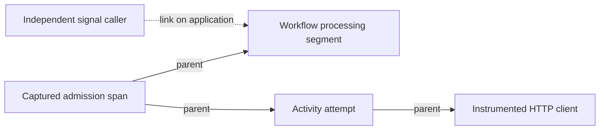

# Embedded tracing preparation

This document describes the optional embedded tracing implementation being
qualified in the [tracing proposal](https://github.com/durable-workflow/workflow/issues/773).
It is not a published-package support claim. The released OpenTelemetry baggage
parser still fails the encoded-value regression. Full qualification and a
compatible stable release are required before enabling this in production.

The application owns its OpenTelemetry providers, instrumentation, sampling,
exporters and process shutdown. Durable Workflow uses those providers when
`workflows.tracing.enabled` is true. It does not replace application providers or
flush an exporter after each task. Tracing is disabled by default.

## Keep collector outages outside business work

PHP exporters can perform synchronous HTTP requests. A batch processor alone
does not guarantee that ending a span is free of network waits. In the tested
SDK, the default batch processor can export from `onEnd()`. Its export-timeout
constructor argument does not impose a timeout on an arbitrary HTTP client.

The tested application profile uses the official OTLP exporter and an explicit
PSR HTTP client. The client limits each request to 100 milliseconds, transport
retries are disabled, and the processor buffers at most four completed spans.
It exports only when the application explicitly flushes or shuts down:

```php
use GuzzleHttp\Client;
use GuzzleHttp\Psr7\HttpFactory;
use OpenTelemetry\API\Common\Time\Clock;
use OpenTelemetry\API\Instrumentation\Configurator;
use OpenTelemetry\Context\Context;
use OpenTelemetry\Contrib\Otlp\ContentTypes;
use OpenTelemetry\Contrib\Otlp\SpanExporter;
use OpenTelemetry\SDK\Common\Export\Http\PsrTransportFactory;
use OpenTelemetry\SDK\Trace\SpanProcessor\BatchSpanProcessor;

$http = new HttpFactory();
$transport = (new PsrTransportFactory(
    new Client(['timeout' => 0.1, 'connect_timeout' => 0.1]),
    $http,
    $http,
))->create($collectorEndpoint, ContentTypes::PROTOBUF, maxRetries: 0);

// The processor captures this context for its own export calls.
$exportScope = Configurator::createNoop()->storeInContext(Context::getRoot())->activate();
try {
    $processor = new BatchSpanProcessor(
        new SpanExporter($transport),
        Clock::getDefault(),
        maxQueueSize: 4,
        maxExportBatchSize: 2,
        autoFlush: false,
    );
} finally {
    $exportScope->detach();
}
```

Add the processor to the application's provider. The optional dependency profile
is in [`.github/tracing-http/composer.json`](../.github/tracing-http/composer.json).
It is separate from the package's required dependencies.
The temporary export context prevents client instrumentation from creating new
spans for collector requests. It restores the application's context immediately
after constructing the processor.

Arrange bounded worker recycling and call the provider's `shutdown()` from the
application's process teardown after its worker loop returns. Flushing and
shutdown belong outside workflow replay, activity callbacks and database
transactions. Reserve time for every queued export batch in the supervisor's
shutdown grace period. Transport deadlines, batch count, retries and other
application processors all contribute to that budget.

This small queue intentionally drops excess spans. Failed exports are reported
by OpenTelemetry's diagnostic logger and are not replayed as workflow work.
`forceFlush()` returning true alone is not proof that a collector accepted every
span. Observe exporter errors and collector ingestion separately. A slow or
unbounded custom processor can still block its caller.

See the [official PHP exporter documentation](https://opentelemetry.io/docs/languages/php/exporters/)
and the tested SDK's [batch processor](https://github.com/opentelemetry-php/sdk/blob/77e1aa73850154abb86937d52a70883edc3b4547/Trace/SpanProcessor/BatchSpanProcessor.php)
and [HTTP transport factory](https://github.com/opentelemetry-php/sdk/blob/77e1aa73850154abb86937d52a70883edc3b4547/Common/Export/Http/PsrTransportFactory.php).

## What this profile currently verifies

Real HTTP controls cover a collector returning 503, a collector that accepts
the request but stalls, and a refused connection. Independent database queue
workers still complete the original workflow and activity once with exact
typed output, unchanged admission context and deadlines, and zero repairs.
No export request occurs before process teardown in these controls.

Separate controls verify the four-span queue limit, overflow loss, failed-export
diagnostics, recovery through the same provider, original application exception
identity, context cleanup and repeated shutdown. The receiver decodes requests
with the official OTLP protobuf classes. These are functional checks, not
overhead, throughput or collector durability measurements.

## Current boundaries

Workflow processing and activity attempts receive separate spans. Persisted
admission context survives the qualified cold-worker, child, continuation and
signal-with-start paths. Existing runs keep their original admission context.
An untraced legacy admission does not borrow a worker's ambient parent.

The existing bridge-authored child-retry policy is covered through both queued
child failure and bridge-recorded failure, followed by separate cold retry,
activity and parent workers. Child admission and retries preserve the original
carrier, retry policy and execution deadline. This does not add retry-policy
options to the PHP `Workflow::child` helper.

Independent-process cancellation controls cover a waiting workflow, a cooperative
request followed by its cleanup activity, and immediate cancellation or
termination. Existing carrier metadata and deadlines remain unchanged. Cleanup
uses the original run's parent, and task scopes restore the worker's context.
An accepted direct cooperative cancellation request also captures its caller
in the proposed command column. Its first actual delivery links that caller
to the workflow-processing span. Duplicate requests keep the first carrier.
Cleanup activities and later replay keep their original parent and add no new
delivery link. Caller baggage never replaces the run's baggage. Internal
descendant requests, immediate cancellation and termination have no caller-link
qualification yet.

Disabling tracing stops new context capture and span emission. These qualified
embedded transitions and child-retry paths still inherit valid stored admission
context while the optional propagation API remains installed. The current
baggage allowlist still applies. Missing or unreadable metadata produces no
inherited parent. Task execution also discards unreadable telemetry metadata
without failing business work or rewriting the stored carrier. Task span
wrappers skip their metadata read when emission is disabled. Transition
inheritance follows the preservation rule above.

## Signal caller links

This draft also proposes a nullable `workflow_commands.observability_context`
column. New accepted embedded signals and signal-with-start commands capture
their own bounded carrier before the admission transaction. Existing command
metadata, including null, stays unchanged. The column is separate from command
context, payloads, history and idempotency. It is hidden from ordinary model JSON.
Each captured run or command carrier is limited to 4 KiB. Links add no durable
history events.

When the embedded executor applies a signal, its processing span links to that
command's captured caller. This includes signals received before the first task
runs and after a real wait. The run's original parent and baggage stay active.
Legacy admissions without a parent keep independent processing segments with
links to their new signal callers. Replaying an already applied signal adds no
new signal-application link.



Links are added during processing. They do not change an earlier head-sampling
decision and are not proof that a transaction committed. Up to 32 distinct
caller trace/span contexts are retained per processing segment. Repeated callers
share a link identified by the first applied command. Further additions are
dropped, with the count in `durable.links.dropped`. Application SDK limits may
be lower. The link state ends with its processing scope.

This does not add service wire propagation, native catalog support, schedule
links or complete fan-in tracing.

## Update caller links

New accepted embedded updates capture their independent caller in the same
proposed command column before the admission transaction. Idempotent duplicate
requests keep the first carrier. Rejected commands do not retain it.

The processing span links to the captured caller immediately before invoking
the accepted handler. This records the processing attempt even when the handler
fails. It does not prove that a transaction committed or that the update
succeeded. The run's parent and baggage remain active. Later replay of a
recorded update adds no new update-application link, even though it can execute
the handler to reconstruct workflow state.

Cold-process controls cover successful and failed updates, duplicate admission,
a rejected undeclared update, later signal/activity completion and legacy or
disabled tracing. They preserve canonical update results/failures, command
identity, typed values, original history and deadlines. The existing per-segment
link bounds also apply to updates. Service/native update propagation and wider
concurrent update cases remain unqualified.

The run carrier is separate observability metadata. It is not command, history,
payload or lease authority. The proposed nullable run column has not been
adopted by the native Server. Other admission paths, broader trigger links,
runtime coverage and performance qualification remain unfinished.

## Processing duration and durable waits

Workflow, activity-attempt and `durable.timer.task` spans cover actual processing.
A timer span starts after its task is claimed and ends after that processing
attempt. No span remains open during the durable wait. Timer scope setup and
teardown happen outside the existing execution transaction.

These optional span attributes describe separate observations, in seconds:

| Attribute | Meaning |
| --- | --- |
| `durable.task.queue_wait_seconds` | Claimed task's `leased_at` minus its `available_at`. The scheduled delay before eligibility is excluded. |
| `durable.task.retry_backoff_seconds` | Exact backoff recorded on a queued activity retry. It is requested delay, not measured execution or total elapsed retry time. |
| `durable.timer.requested_wait_seconds` | Delay recorded on the claimed timer. |
| `durable.timer.lateness_seconds` | Timer task claim minus the original timer deadline. |

The values come from the already-claimed snapshot and add no telemetry query.
Missing, unreadable, malformed or negative timing observations are omitted.
Second and fractional database precision are supported. Stored clock deltas can
reflect clock adjustments and queue/scheduler delays; they are not monotonic
latency or a new authority rule. Existing eligibility, deadlines, retry policy
and history remain authoritative. Timing attributes are not added to log
correlation fields or automatically used as metric labels.

The current controls cover cold embedded timer workers and a real queued
activity failure/backoff/retry, including disabled emission and a legacy
admission. Broader backend/runtime, local-activity, timeout and exporter-failure
qualification for timer processing remains unfinished. No performance gain or
overhead acceptance is claimed by these functional checks.
