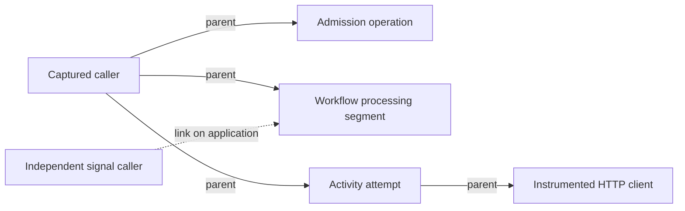

# Embedded tracing preparation

This document describes the optional embedded tracing implementation being
qualified in the [tracing proposal](https://github.com/durable-workflow/workflow/issues/773).
It is not a published-package support claim. OpenTelemetry API 1.10.1 fixes the
encoded-value baggage regression and is the minimum supported API version.
Full qualification and a compatible Durable Workflow release are required
before enabling this in production.

The application owns its OpenTelemetry providers, instrumentation, sampling,
exporters and process shutdown. Durable Workflow uses those providers when
`workflows.tracing.enabled` is true. It does not replace application providers or
flush an exporter after each task. Tracing is disabled by default.

An unavailable tracing-enabled setting disables instrumentation for that
operation. An unavailable or non-array baggage allowlist permits no baggage;
only string entries are used. Neither optional setting can prevent admission,
timer or activity execution, or replace the workflow's own failure.

## Configure the source integration

In a qualification application, use one application-owned environment flag for
tracing and its optional log tap. Set `DW_TRACING_ENABLED=true` in that
application's environment, then configure the existing `tracing` section of
`config/workflows.php`:

```php
'tracing' => [
    'enabled' => (bool) env('DW_TRACING_ENABLED', false),
    'baggage_allowlist' => [],
],
```

The empty allowlist propagates no baggage. Add only the application-approved
keys that must cross durable boundaries. The application's installed
propagator must support those fields. Install OpenTelemetry API `^1.10.1` when
using tracing. Older APIs have an incompatible baggage parser, so Composer
rejects those versions. Applications without OpenTelemetry do not gain a new
required dependency.
The package reads the configured boolean; the environment mapping above is
part of the application example.

Register the application's chosen OpenTelemetry provider and propagators
before admitting or processing workflows. Existing compatible HTTP/database
instrumentation then uses the active standard context inside an activity.
The application continues to own sampling, export and process shutdown.
The [optional HTTP dependency profile](../.github/tracing-http/composer.json)
shows the packages used by the source controls, with the exporter limits
described below.

### Laravel log correlation

Append the supported tap to each existing Laravel channel used by the workflow,
activity and injected services. In that channel's `config/logging.php` entry:

```php
'tap' => [
    // Keep the channel's existing taps here.
    ...((bool) env('DW_TRACING_ENABLED', false)
        ? [\Workflow\V2\Tracing\LogContext::class]
        : []),
],
```

Load this configuration before the channel is resolved. Choose a formatter
that emits the record's `context` fields, such as Monolog's `JsonFormatter`.
Enabling span emission alone does not install this channel tap. Application
code can keep its ordinary `Log::info(...)` calls and injected logger usage.
The [cold HTTP/worker control](../tests/Unit/V2/IncomingHttpTracingTest.php)
checks both actual callback logs and spans after the request process exits.

The tap reads only the active durable scope. It restores ordinary logging
outside that scope and preserves an existing application `request_id`. Logging
adapter errors leave the original record usable.

Restart the application's workers after changing their loaded configuration.
The overhead recipe uses this conditional tap profile. Always-installed custom
logging processors need their own measurement.

## Correlation fields and instrumentation scope

The tracing scope name is `durable-workflow/workflow`. Its version comes from
Composer's installed pretty version when available. A development or benchmark
alias remains that alias; it is not evidence of a published release.

The current operation supplies these bounded fields when their identities are
available:

| Field | Meaning |
| --- | --- |
| `workflow_instance_id` | Logical workflow identity, which can have multiple runs. |
| `workflow_run_id` | The exact run being admitted or processed. |
| `workflow_type` | The recorded workflow type. |
| `namespace` | The operation's namespace when scoped. |
| `task_id` | The current physical task. |
| `activity_id` | Logical activity identity, retained across its ordinary retries. |
| `activity_type` | The authored activity type. |
| `activity_attempt_id` | The concrete activity attempt when available. |
| `activity_attempt_number` | The positive attempt number. |
| `request_id` | Application-supplied request correlation, kept separate from durable identities. |
| `trace_id`, `span_id` | Active OpenTelemetry context identifiers, also exposed to the log tap. |
| `timer_id` | The timer associated with a timer operation. |
| `workflow_command_id` | The command associated with an admission or delivery. |
| `schedule_id` | The schedule associated with a trigger. |

Trace and span IDs are part of OpenTelemetry's span context. They are not
duplicated as custom span attributes. Missing or invalid optional fields are
omitted. Runtime-supplied string correlation fields are bounded to 512 bytes
and exclude control characters; attempt numbers remain integers. Existing
application log context retains its application-defined format.

Durable identifiers come from the current execution scope. An existing
`request_id` on a log record keeps its application meaning. These identifiers
are not automatically used as metric labels. The integration excludes workflow
arguments, results, HTTP bodies and credentials from its default attributes.
Application-chosen identifiers and explicitly allowlisted baggage still need
the access controls appropriate to their contents.

## Runtime and SDK qualification

This matrix describes this draft's durable propagation and correlation
contract. Ordinary application HTTP instrumentation has a separate scope.

| Runtime or client | Scope established by this draft | Support status |
| --- | --- | --- |
| Embedded Laravel | Source controls cover incoming HTTP context, separate queue workers, retries, recovery and the transitions described below. | Unreleased. Baggage, remaining full gates and overhead acceptance still block stable support. |
| PHP Server | This embedded draft adds no service transport contract. | Separate integration and consumer qualification required. |
| Rust Server draft | Proposed observability columns and carriers have not been adopted by its catalog. | Unqualified for this contract. |
| Cloud | No deployment of this draft is claimed. | Separate release and deployment qualification required. |
| PHP service SDK | No durable carrier API or service propagation is added here. | Unqualified for this contract. |
| Python service SDK | No durable carrier API or service propagation is added here. | Unqualified for this contract. |
| Rust service SDK | No durable carrier API or service propagation is added here. | Unqualified for this contract. |

The package's optional tracing API can be absent, and tracing is disabled by
default. In those modes the execution callback still runs with its ordinary
business outcome. Enabling this source requires review of its proposed nullable
`observability_context` columns on runs, commands and tasks. Existing rows keep
null metadata. Older executions use independent processing segments instead
of borrowing an unrelated worker's parent. Canonical histories, command receipt
comparisons, retry policies and deadlines retain their existing contracts.

Worker processes can handle successive jobs, but this integration scopes
context to the current operation. It does not keep one execution span open
for the lifetime of a worker session. Concurrent Fiber and cold-process controls
check the scope restoration described below.

## Keep collector outages outside business work

PHP exporters can perform synchronous HTTP requests. A batch processor alone
does not guarantee that ending a span is free of network waits. In the tested
SDK, the default batch processor can export from `onEnd()`. Its export-timeout
constructor argument does not impose a timeout on an arbitrary HTTP client.

The tested application profile uses the official OTLP exporter and an explicit
PSR HTTP client. The client limits each request to 100 milliseconds, transport
retries are disabled, and the processor buffers at most four completed spans.
It exports only when the application explicitly flushes or shuts down:

```php
use GuzzleHttp\Client;
use GuzzleHttp\Psr7\HttpFactory;
use OpenTelemetry\API\Common\Time\Clock;
use OpenTelemetry\API\Instrumentation\Configurator;
use OpenTelemetry\Context\Context;
use OpenTelemetry\Contrib\Otlp\ContentTypes;
use OpenTelemetry\Contrib\Otlp\SpanExporter;
use OpenTelemetry\SDK\Common\Export\Http\PsrTransportFactory;
use OpenTelemetry\SDK\Trace\SpanProcessor\BatchSpanProcessor;

$http = new HttpFactory();
$transport = (new PsrTransportFactory(
    new Client(['timeout' => 0.1, 'connect_timeout' => 0.1]),
    $http,
    $http,
))->create($collectorEndpoint, ContentTypes::PROTOBUF, maxRetries: 0);

// The processor captures this context for its own export calls.
$exportScope = Configurator::createNoop()->storeInContext(Context::getRoot())->activate();
try {
    $processor = new BatchSpanProcessor(
        new SpanExporter($transport),
        Clock::getDefault(),
        maxQueueSize: 4,
        maxExportBatchSize: 2,
        autoFlush: false,
    );
} finally {
    $exportScope->detach();
}
```

Add the processor to the application's provider. The optional dependency profile
is in [`.github/tracing-http/composer.json`](../.github/tracing-http/composer.json).
It is separate from the package's required dependencies.
The temporary export context prevents client instrumentation from creating new
spans for collector requests. It restores the application's context immediately
after constructing the processor.

Arrange bounded worker recycling and call the provider's `shutdown()` from the
application's process teardown after its worker loop returns. Flushing and
shutdown belong outside workflow replay, activity callbacks and database
transactions. Reserve time for every queued export batch in the supervisor's
shutdown grace period. Transport deadlines, batch count, retries and other
application processors all contribute to that budget.

This small queue intentionally drops excess spans. Failed exports are reported
by OpenTelemetry's diagnostic logger and are not replayed as workflow work.
`forceFlush()` returning true alone is not proof that a collector accepted every
span. Observe exporter errors and collector ingestion separately. A slow or
unbounded custom processor can still block its caller.

See the [official PHP exporter documentation](https://opentelemetry.io/docs/languages/php/exporters/)
and the tested SDK's [batch processor](https://github.com/opentelemetry-php/sdk/blob/77e1aa73850154abb86937d52a70883edc3b4547/Trace/SpanProcessor/BatchSpanProcessor.php)
and [HTTP transport factory](https://github.com/opentelemetry-php/sdk/blob/77e1aa73850154abb86937d52a70883edc3b4547/Common/Export/Http/PsrTransportFactory.php).

## What this profile currently verifies

Real HTTP controls cover a collector returning 503, a collector that accepts
the request but stalls, and a refused connection. Independent database queue
workers still complete the original workflow and activity once with exact
typed output, unchanged admission context and deadlines, and zero repairs.
No export request occurs before process teardown in these controls.

Separate controls verify the four-span queue limit, overflow loss, failed-export
diagnostics, recovery through the same provider, original application exception
identity, context cleanup and repeated shutdown. The receiver decodes requests
with the official OTLP protobuf classes. These are functional checks, not
overhead, throughput or collector durability measurements.

## Current boundaries

Ordinary embedded starts emit a short `durable.workflow.admission` span when
tracing is enabled. It is an internal operation under the application's current
context. The span reports the returned start receipt, including a new run,
return of an existing active run or duplicate refusal. Unexpected application
exceptions retain their original identity. Optional telemetry failures do not
replace the admission result.

The durable carrier is captured before this span starts. Later workers remain
children of that original caller, rather than the admission span. Duplicate
attempts have their own admission spans and keep the original run carrier and
deadlines. Span creation and completion occur outside the admission transaction.
The application owns processors, so a synchronous processor can still delay its
caller. The bounded-export guidance above also applies to admission spans.

Embedded signal-with-start uses the same admission span. The primary command
attributes describe its signal receipt. If a start command was actually
recorded, `durable.start.command_id`, `durable.start.status` and
`durable.start.outcome` identify that paired decision. A rejected signal can
have no paired start command; tracing does not invent one. Each signal keeps
its captured caller for later delivery links, while an existing run keeps its
original parent and deadlines. Legacy and no-parent admissions are included in
the cold-process controls. Embedded schedule controls are described below;
service admission and wider runtime coverage remain unqualified.

Workflow processing and activity attempts receive separate spans. Persisted
admission context survives the qualified cold-worker, child, continuation and
signal-with-start paths. Existing runs keep their original admission context.
An untraced legacy admission does not borrow a worker's ambient parent.

An embedded local callback uses an internal `durable.local_activity.attempt`
span for its object construction, injected dependencies and handler. It inherits
the active hosting workflow task only when instance, run, namespace and task
all match. Otherwise it uses the stored admission parent, or a root for a legacy
run. Each retry has its own attempt span. History replay, refused attempts and
mocked results do not emit callback spans. Local attempts have no activity-queue
wait measurement. The span ends before outcome recording, and the existing
execution transaction and retry dispatch rules remain unchanged.

Cold parallel-workflow controls use a local callback followed by a group of
two ordinary activities and a timer, including a genuine activity retry.
Independent queue processes retain the original admission parent and restore
their previous context. Each callback attempt has its own identity and span;
replaying the completed local callback adds no attempt span. The same recipe
covers tracing disabled, a legacy admission, and workers disabled after a
traced admission. It preserves the complete retry snapshots, original
deadlines and history prefixes, with zero repairs.

The local callback precedes the parallel group. The existing `all()` API does
not admit local-activity descriptors as group members. Simultaneous-worker
load and large-fan-out overhead remain separate qualification gates.

### Outcome links (draft)

The draft adds a nullable, internal `workflow_tasks.observability_context`
column. A recording task can retain its actual outcome span context alongside
its existing task update. Entries bind the physical history event ID, sequence
and type to the original task, run, namespace and activity attempt or timer.
They carry no baggage or business result, are hidden from task JSON, and grant
no completion, retry or lease authority. The business history is unchanged.

Local callbacks retain their actual span context until the hosting task records
the outcome. Ordinary activity and timer scopes capture their context before
outcome SQL. This uses the official W3C propagator directly, without invoking
application propagation hooks inside an execution transaction. Rollback removes
pending entries; duplicate completion cannot replace the first stored context.
Missing legacy columns and invalid optional metadata supply no outcome links.

Before an enabled workflow task executes, it can read the latest 32 eligible
physical outcomes and their scoped task metadata outside the execution
transaction. Consuming a matching activity result or fired timer adds a
`durable.link.type=task_outcome` link to that actual span. The workflow span's
original admission parent remains unchanged. Each task carrier is capped at
4 KiB and 32 complete entries; the existing processing-segment link cap also
applies. Older outcomes outside this window can have no link. Disabled workers
perform no additional outcome-metadata reads or writes.

Parent processing also prefetches at most 32 original child links and 32
physical completed/failed child outcomes. Consuming a child resolution can add
`durable.link.type=child_outcome` only when the original parent link, authored
sequence, namespace/run/task bindings and physical terminal event all match.
The child history must already be loaded by execution; adding the link performs
no observation SQL. A missing or mismatched optional observation does not change
child resolution. Root and child observations share the existing 32-link
processing-segment cap; either bounded read window can omit older outcomes.

When a recording processing segment consumes a prior physical outcome without
usable matching context, it sets
`durable.links.outcome_context_unavailable=true`. This boolean does not count
missing spans or identify why context is unavailable. It does not apply to a
foreign run or to outcomes represented by the current task's active scope.
Its absence does not prove that a trace graph is complete. The separate
`durable.links.dropped` attribute still reports the processing-segment link cap.

Cold SQLite controls check the actual contributing local activity, ordinary
activity and timer span IDs, including genuine retries and handled terminal
activity failures. Parent links cover completed and failed children, with
disabled/legacy modes and wrong-task/namespace metadata controls. Transaction
rollback, duplicate decisions and legacy migration are exercised separately.
Timeout/cancellation causality, concurrent/large fan-out, multi-backend
acceptance and overhead remain separate qualification gates.
The new column remains unreleased and is not adopted by the service wire or
native catalogs.

Queue dispatch emits a short `durable.task.dispatch` producer span outside the
database transaction. It covers the queue dispatcher call. A returned call is
not proof that a worker claimed or completed the task. Poll mode and fake
execution do not emit queue producer spans.

The queued job can carry a bounded trace context tied to its exact task ID.
Cold workflow, activity and timer consumers link the producer as
`durable.link.type=queue_dispatch`; their parent remains the original persisted
run context. Queue metadata carries no baggage, payload, lease or deadline
authority. Missing, malformed or mismatched metadata supplies no dispatch link.
Legacy serialized jobs remain readable, and disabled tracing leaves newly
created jobs' serialized form unchanged. The service protocol is unchanged.

The existing bridge-authored child-retry policy is covered through both queued
child failure and bridge-recorded failure, followed by separate cold retry,
activity and parent workers. Child admission and retries preserve the original
carrier, retry policy and execution deadline. This does not add retry-policy
options to the PHP `Workflow::child` helper.

Independent-process cancellation controls cover a waiting workflow, a cooperative
request followed by its cleanup activity, and immediate cancellation or
termination. Existing carrier metadata and deadlines remain unchanged. Cleanup
uses the original run's parent, and task scopes restore the worker's context.
An accepted direct cooperative cancellation request also captures its caller
in the proposed command column. Its first actual delivery links that caller
to the workflow-processing span. Duplicate requests keep the first carrier.
Cleanup activities and later replay keep their original parent and add no new
delivery link. Caller baggage never replaces the run's baggage. Internal
descendant requests, immediate cancellation and termination have no caller-link
qualification yet.

Disabling tracing stops new context capture and span emission. These qualified
embedded transitions and child-retry paths still inherit valid stored admission
context while the optional propagation API remains installed. The current
baggage allowlist still applies. Missing or unreadable metadata produces no
inherited parent. Task execution also discards unreadable telemetry metadata
without failing business work or rewriting the stored carrier. Task span
wrappers skip their metadata read when emission is disabled. Transition
inheritance follows the preservation rule above.

## Schedule triggers

Embedded PHP schedules emit a short `durable.schedule.trigger` internal span
around the trigger operation. Its processor starts and ends outside the
runtime-owned schedule transaction. The schedule's occurrence, overlap, action
budget and atomic admission decisions are unchanged. An application that wraps
the call in its own transaction still owns that outer boundary.
Synchronous start listeners retain the workflow instance and type in their
correlation fields without starting another span under the schedule lock.

The actual triggering caller is captured before the trigger span. An admitted
run persists that caller for later workers; its cold processing spans do not
become children of the short trigger span. Creating a schedule does not persist
the creator's trace for future runs. Manual and periodic triggers have separate
cold-worker controls, including disabled tracing and an unrelated worker parent.

Span attributes include `schedule_id`, namespace and
`durable.schedule.trigger_kind`: `manual`, `scheduled`, `buffered` or `backfill`.
Returned identities, `durable.schedule.outcome` and `durable.schedule.reason`
are attached when available. Backfill's instance-only return does not invent a
run ID. A buffered receipt is not an admitted run or a completed workflow.

An accepted buffered trigger keeps its bounded caller carrier alongside that
specific buffered action in the internal `observability_context` field. A full
buffer keeps the first entry and its caller. The public schedule detail omits
this optional field, and tracing disabled at admission stores no carrier.

The later drain keeps its actual scheduler parent and adds a
`buffered_schedule` link to the buffered caller after the runtime-owned admission
transaction commits. A rolled-back admission retains the original entry and
adds no success link. Legacy entries and malformed metadata produce no link;
they retain the normal scheduling behavior. The caller's baggage is not imported
into the drain. Separate cold processes qualify traced, disabled, full-buffer,
legacy/malformed and rollback-then-success paths with unchanged run deadlines,
typed results and first-attempt tasks.
Both `buffer_one` and ordered `buffer_all` draining have cold-process controls;
successive entries link their own callers rather than reusing the first caller.

Cold backfill controls cover traced and disabled admission, an already-fired
occurrence, rollback and a later successful admission of that same occurrence.
Independent queue workers retain the actual backfill caller as their parent.
The failed admission reports an error without a successful instance or run
identity. Duplicate and failed admissions preserve the original run, carrier,
history and deadlines. A later occurrence gets its own caller without changing
the earlier completed run. Disabled controls keep the same business outcomes
without capturing a carrier or emitting spans.

These schedule controls add no schedule column or service wire field. The
internal buffered metadata has no stable or native adoption claim. Full tracing
acceptance, broader gates and overhead measurements remain unfinished.

## Signal caller links

This draft also proposes a nullable `workflow_commands.observability_context`
column. New accepted embedded signals and signal-with-start commands capture
their own bounded carrier before the admission transaction. Existing command
metadata, including null, stays unchanged. The column is separate from command
context, payloads, history and idempotency. It is hidden from ordinary model JSON.
Each captured run or command carrier is limited to 4 KiB. Links add no durable
history events.

When the embedded executor applies a signal, its processing span links to that
command's captured caller. This includes signals received before the first task
runs and after a real wait. The run's original parent and baggage stay active.
Legacy admissions without a parent keep independent processing segments with
links to their new signal callers. Replaying an already applied signal adds no
new signal-application link.



Links are added during processing. They do not change an earlier head-sampling
decision and are not proof that a transaction committed. Up to 32 distinct
caller trace/span contexts are retained per processing segment. Repeated callers
share a link identified by the first applied command. Further additions are
dropped, with the count in `durable.links.dropped`. Application SDK limits may
be lower. The link state ends with its processing scope.

This does not add service wire propagation, native catalog support or complete
fan-in tracing.

## Update caller links

New accepted embedded updates capture their independent caller in the same
proposed command column before the admission transaction. Idempotent duplicate
requests keep the first carrier. Rejected commands do not retain it.

The processing span links to the captured caller immediately before invoking
the accepted handler. This records the processing attempt even when the handler
fails. It does not prove that a transaction committed or that the update
succeeded. The run's parent and baggage remain active. Later replay of a
recorded update adds no new update-application link, even though it can execute
the handler to reconstruct workflow state.

Cold-process controls cover successful and failed updates, duplicate admission,
a rejected undeclared update, later signal/activity completion and legacy or
disabled tracing. They preserve canonical update results/failures, command
identity, typed values, original history and deadlines. The existing per-segment
link bounds also apply to updates. Service/native update propagation and wider
concurrent update cases remain unqualified.

The run carrier is separate observability metadata. It is not command, history,
payload or lease authority. The proposed nullable run column has not been
adopted by the native Server. Other admission paths, broader trigger links,
runtime coverage and performance qualification remain unfinished.

## Processing duration and durable waits

Workflow, activity-attempt and `durable.timer.task` spans cover actual processing.
A timer span starts after its task is claimed and ends after that processing
attempt. No span remains open during the durable wait. Timer scope setup and
teardown happen outside the existing execution transaction.

These optional span attributes describe separate observations, in seconds:

| Attribute | Meaning |
| --- | --- |
| `durable.task.queue_wait_seconds` | Claimed task's `leased_at` minus its `available_at`. The scheduled delay before eligibility is excluded. |
| `durable.task.retry_backoff_seconds` | Exact backoff recorded on a queued activity retry. It is requested delay, not measured execution or total elapsed retry time. |
| `durable.timer.requested_wait_seconds` | Delay recorded on the claimed timer. |
| `durable.timer.lateness_seconds` | Timer task claim minus the original timer deadline. |

The values come from the already-claimed snapshot and add no telemetry query.
Missing, unreadable, malformed or negative timing observations are omitted.
Second and fractional database precision are supported. Stored clock deltas can
reflect clock adjustments and queue/scheduler delays; they are not monotonic
latency or a new authority rule. Existing eligibility, deadlines, retry policy
and history remain authoritative. Timing attributes are not added to log
correlation fields or automatically used as metric labels.

The current controls cover cold embedded timer workers and a real queued
activity failure/backoff/retry, including disabled emission and a legacy
admission. Broader backend/runtime, local-activity, timeout and exporter-failure
qualification for timer processing remains unfinished. No performance gain or
overhead acceptance is claimed by these functional checks.
